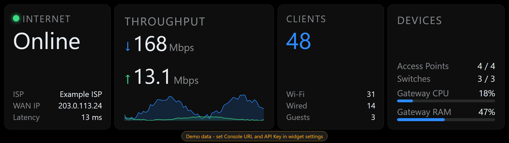
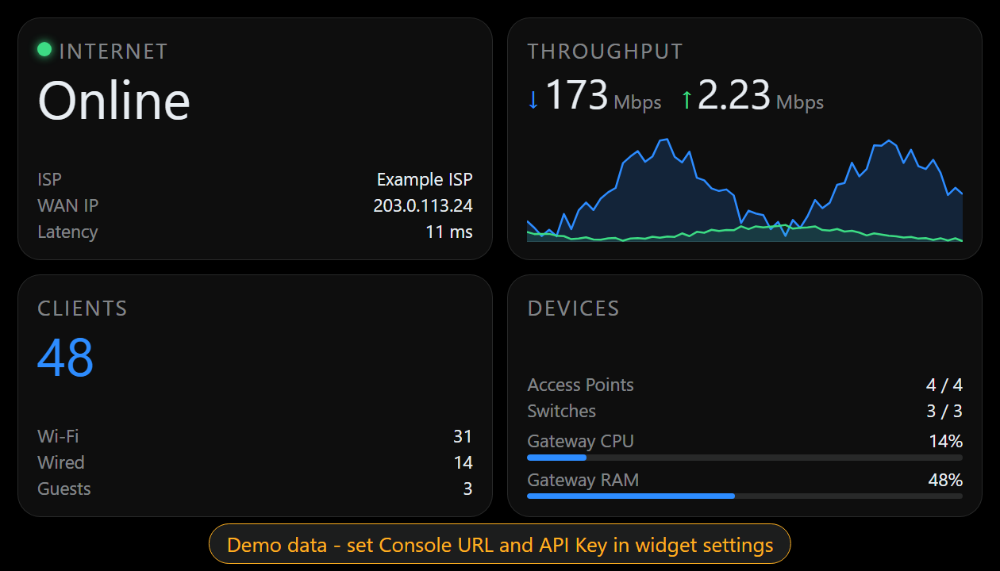
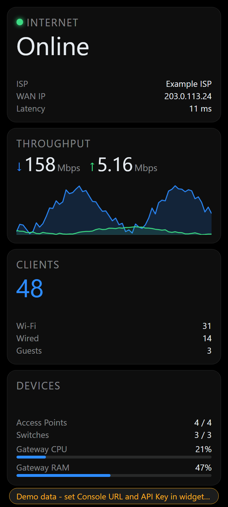

# icue-widgets

Custom widgets for **CORSAIR iCUE**, built for the **XENEON EDGE** 14.5" touchscreen (2560×720).

iCUE widgets are small HTML/CSS/JS apps. Each one is packaged as a `.icuewidget` file and imported into iCUE. Every widget here adapts to any tile size and orientation on the Edge: wide, square, or portrait.

## Widgets

| Widget | Description | Status |
|---|---|---|
| [UniFi Stats](widgets/unifi-stats) | Live UniFi network dashboard: internet status, WAN throughput graph, client counts, device health, gateway CPU/RAM | v1.0.0 — browser-tested, iCUE testing in progress |

**Planned:** UniFi Protect camera grid, plus more UniFi cards (top clients, switch ports, guest Wi-Fi QR). See [docs/handoff-unifi.md](docs/handoff-unifi.md).

### UniFi Stats



<p>
  
  
</p>

- **Data:** reads the UniFi OS console's local Network API using an API key.
- **Demo mode:** with no key set, it shows demo data.
- **Fallback proxy:** if iCUE blocks the console's self-signed certificate, run [tools/unifi-proxy](tools/unifi-proxy) and point the widget at it.

## Installing a widget

1. Download the `.icuewidget` file from [`dist/`](dist).
2. In iCUE, open **Widgets** and click **+**, then select the file.
3. Add the widget to an XENEON EDGE tile and open its settings.

**Requirements:** iCUE 5.47 or later, on Windows.

## Building from source

Widgets use [`icuewidget-cli`](https://www.npmjs.com/package/icuewidget-cli). There is no build step beyond packaging.

```bash
npx icuewidget-cli validate widgets/<name>
npx icuewidget-cli package widgets/<name> -o dist/<name>-<version>.icuewidget
```

To preview a widget in a normal browser, open `widgets/<name>/index.html` directly. Settings fall back to their defaults and can be overridden with query parameters, for example `index.html?apiKey=...`.

## Repository layout

```
widgets/<name>/   widget source (each folder is packaged as-is)
dist/             built .icuewidget packages
tools/            helpers that are not packaged (e.g. unifi-proxy)
docs/             handoff notes and plans
```

Official widget docs: https://docs.elgato.com/icue/widgets/

## License

[Apache 2.0](LICENSE)
